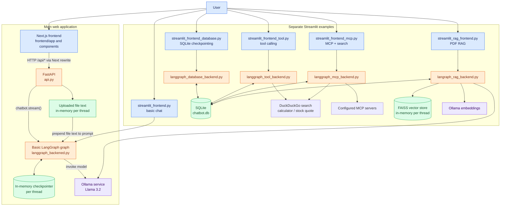
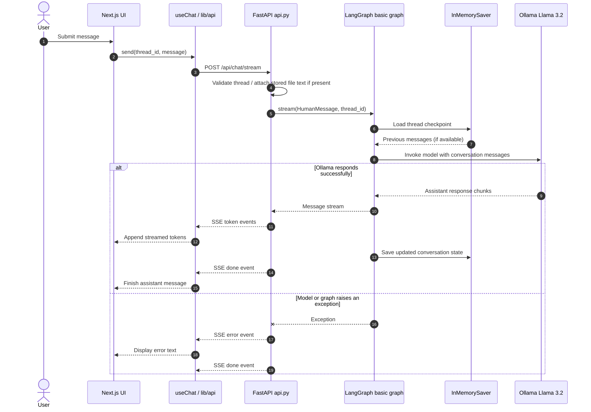
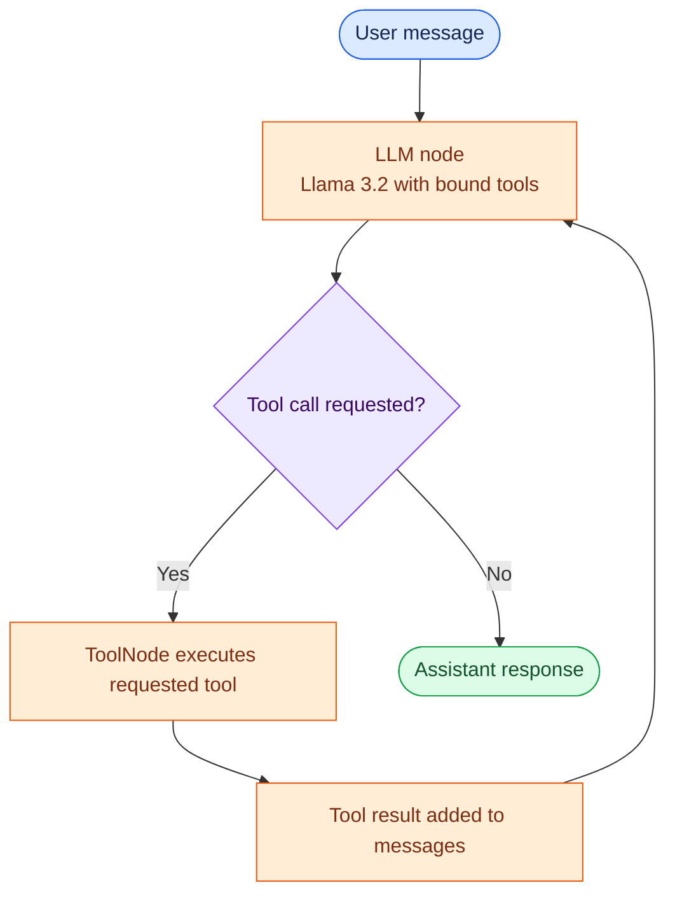

# Atlas AI — LangGraph Chatbot Suite

A modular local-first chatbot suite built with LangGraph, Ollama, FastAPI, Streamlit, and Next.js.

Atlas AI provides several chatbot implementations: a basic conversational assistant, checkpoint-backed conversation variants, tool-enabled agents, and a PDF question-answering workflow. It is intended for developers exploring LangGraph orchestration, local LLM applications, tool calling, persistence, and retrieval-augmented generation (RAG).

## Table of Contents

- [Overview](#overview)
- [Key Features](#key-features)
- [System Architecture](#system-architecture)
- [Request Flow](#request-flow)
- [Technology Stack](#technology-stack)
- [Repository Structure](#repository-structure)
- [How It Works](#how-it-works)
- [Configuration](#configuration)
- [Getting Started](#getting-started)
- [Usage](#usage)
- [Design Decisions](#design-decisions)
- [Limitations and Future Improvements](#limitations-and-future-improvements)
- [Testing](#testing)
- [Contributing](#contributing)
- [License](#license)
- [Assumptions](#assumptions)

## Overview

The project demonstrates how to connect a chat interface to a graph-based assistant and extend that assistant with persistence, tools, and document retrieval.

The repository contains multiple independent entry points rather than one application that dynamically switches between every backend:

- The **Atlas AI web application** uses a FastAPI API, a Next.js frontend, and the basic Ollama-backed LangGraph chatbot.
- The **Streamlit applications** demonstrate basic chat, SQLite checkpointing, tool calling, MCP integrations, streaming, and PDF RAG.
- The default model integration is **Llama 3.2 through a locally running Ollama service**.

The current web API does not select among model providers. It invokes the basic chatbot defined in `langgraph_backened.py`.

## Key Features

- **Local LLM chat:** Uses `ChatOllama(model="llama3.2")` for chat completion.
- **LangGraph conversation state:** Uses a graph state containing messages and the `add_messages` reducer.
- **Thread-based conversations:** Passes a `thread_id` to LangGraph so messages are associated with a conversation.
- **Multiple checkpointing examples:** Includes in-memory and SQLite-backed LangGraph checkpointers.
- **Tool calling:** The tool backend exposes DuckDuckGo search, a calculator, and a stock-price function to the LLM.
- **MCP integration example:** Connects to configured MCP servers and adds discovered MCP tools to the tool-enabled graph.
- **PDF RAG example:** Extracts PDF pages, splits text into chunks, embeds them with Ollama embeddings, and retrieves up to four similar chunks through FAISS.
- **File attachment in the web app:** Accepts an uploaded file, extracts text, and injects that text into the next chat prompt for the thread.
- **Streaming responses:** Streams LangGraph message output through Server-Sent Events (SSE) in FastAPI and through Streamlit's streaming APIs in selected apps.
- **Next.js chat interface:** Includes conversation list management, message rendering, Markdown/code rendering, file attachment UI, and theme switching.
- **Alternative Streamlit interfaces:** Provides separate Python UIs for the basic, database, tool, MCP, and PDF RAG backends.

## System Architecture

The repository has several backend variants. The following diagram shows the main web application and the separate Streamlit paths. It does not imply that the web API automatically routes requests to every backend.



### Architecture notes

- The main web app imports only `langgraph_backened.chatbot`. It therefore uses the basic Llama chat graph, not the search/tool/MCP/RAG variants.
- The web upload endpoint extracts PDF text with pypdf; other uploaded files are decoded as UTF-8. The extracted text is truncated to 60,000 characters and inserted into the prompt. This web upload path is prompt-context injection, not vector-based RAG.
- The PDF RAG implementation is in `langraph_rag_backend.py` and is used by `streamlit_rag_frontend.py`.
- The tool and MCP backends use a LangGraph tool loop. Their tools are not wired into the main FastAPI application.

## Request Flow

This sequence diagram describes a normal message in the **Next.js + FastAPI web application**. The current web path has one configured LLM provider (Ollama); there is no provider-selection router. Tool and web-search calls are shown separately because they exist in the alternate Streamlit backends, not in the web API's basic graph.



### Alternate tool and RAG flows

The tool-enabled graphs use `tools_condition` to decide whether the LLM response requested a tool call. If so, LangGraph executes the `ToolNode`, adds the tool result to message state, and loops back to the LLM. Otherwise the graph ends.



In the PDF RAG backend, a PDF is loaded and split into chunks, embedded into a per-thread FAISS store, and retrieved when the LLM invokes `rag_tool`. The retrieved passages and metadata are returned to the tool-calling graph; the LLM then produces the user-facing answer.

## Technology Stack

| Layer | Technology | Role |
|---|---|---|
| Web frontend | Next.js 16, React 19, TypeScript | Chat UI, thread sidebar, file upload, streamed message display |
| UI styling | Tailwind CSS 4, clsx, tailwind-merge | Styling and class-name composition |
| UI interaction | Framer Motion, Lucide React, next-themes | Animations, icons, theme switching |
| Markdown/code display | react-markdown, remark-gfm, react-syntax-highlighter, rehype-highlight | Render Markdown, tables, and code blocks |
| API | FastAPI, Uvicorn, Pydantic | HTTP endpoints and SSE response stream |
| Agent orchestration | LangGraph | Graph state, nodes, conditional tool routing, checkpoint integration |
| LLM integration | LangChain, langchain-ollama | Chat model and embedding integration |
| Default chat model | Ollama, Llama 3.2 | Local language-model inference |
| Tool integrations | DuckDuckGoSearchRun, requests, LangChain tools | Web search, calculator, stock quote request |
| MCP integration | langchain-mcp-adapters | Discover tools from configured MCP servers |
| PDF parsing | pypdf, PyPDFLoader | Extract PDF text and page documents |
| Text splitting | RecursiveCharacterTextSplitter | Split PDF content into overlapping chunks |
| Vector retrieval | FAISS (faiss-cpu) | Similarity retrieval over uploaded PDF chunks |
| Checkpoint storage | LangGraph InMemorySaver / SqliteSaver / AsyncSqliteSaver | Conversation state persistence depending on backend |
| Python UI | Streamlit | Alternative chat interfaces |

## Repository Structure

```text
chatbot/
├── api.py                         # FastAPI endpoints, uploads, SSE streaming, in-memory thread metadata
├── langgraph_backened.py          # Basic Llama 3.2 chat graph with in-memory checkpointing
├── langgraph_database_backend.py  # Chat graph with SQLite checkpointing
├── langgraph_tool_backend.py      # Tool-enabled graph: search, calculator, stock quote
├── langgraph_mcp_backend.py       # Async MCP client, search and stock tool graph
├── langraph_rag_backend.py        # PDF ingestion, FAISS retrieval, RAG and tool-enabled graph
├── requirements.txt               # Python dependencies
├── .gitignore                     # Ignore rules for environments, secrets and generated files
├── README.md                      # Project documentation
├── streamlit_frontend.py          # Basic Streamlit chat interface
├── streamlit_frontend_streaming.py# Basic chat with streamed LangGraph messages
├── streamlit_frontend_threading.py# Threaded tool-chat Streamlit interface
├── streamlit_frontend_database.py # SQLite-checkpointed conversation interface
├── streamlit_frontend_tool.py     # Tool-calling Streamlit interface with tool status
├── streamlit_frontend_mcp.py      # MCP-enabled Streamlit interface
├── streamlit_rag_frontend.py      # PDF upload and RAG Streamlit interface
└── frontend/
    ├── package.json               # Frontend scripts and dependencies
    ├── package-lock.json           # Locked npm dependency tree
    ├── next.config.ts              # Rewrites /api requests to FastAPI on localhost:8000
    ├── tsconfig.json               # TypeScript compiler configuration and @ alias
    ├── eslint.config.mjs           # Next.js ESLint configuration
    ├── postcss.config.mjs          # Tailwind CSS PostCSS plugin
    ├── .gitignore                  # Frontend-generated file ignore rules
    ├── AGENTS.md                   # Next.js-specific repository guidance
    ├── CLAUDE.md                   # References AGENTS.md
    ├── README.md                   # Default create-next-app documentation
    ├── app/
    │   ├── layout.tsx              # Root layout, metadata and theme provider
    │   ├── page.tsx                # Main chat page and thread selection state
    │   ├── globals.css             # Global styles and scrollbar styling
    │   └── favicon.ico             # Browser favicon
    ├── components/
    │   ├── ChatInput.tsx           # Message input, upload and drag/drop UI
    │   ├── ChatWindow.tsx          # Message list and empty state
    │   ├── CodeBlock.tsx           # Syntax highlighting, copy and download controls
    │   ├── EmptyState.tsx          # Starter prompts
    │   ├── MarkdownRenderer.tsx    # Markdown/GFM rendering
    │   ├── Message.tsx             # User/assistant message bubble
    │   ├── Sidebar.tsx             # Thread list, search, rename and delete UI
    │   ├── ThemeProvider.tsx       # next-themes provider
    │   ├── ThemeToggle.tsx         # Dark/light theme control
    │   └── TypingIndicator.tsx     # Animated assistant typing indicator
    ├── hooks/
    │   ├── useChat.ts              # Chat state and streamed token handling
    │   └── useThreads.ts           # Thread CRUD and client-side thread state
    ├── lib/
    │   ├── api.ts                  # Browser-side API functions and SSE parser
    │   └── utils.ts                # Tailwind class merging helper
    ├── types/
    │   └── index.ts                # Message and Thread TypeScript interfaces
    └── public/
        ├── file.svg                # Static file icon asset
        ├── globe.svg               # Static globe icon asset
        ├── next.svg                # Next.js logo asset
        ├── vercel.svg              # Vercel logo asset
        └── window.svg              # Static window icon asset
```

## How It Works

### 1. Basic LangGraph chatbot

File: `langgraph_backened.py`

- Creates `ChatOllama(model="llama3.2")`.
- Defines `ChatState` with a `messages` field using the `add_messages` reducer.
- `chat_node(state)` sends the current message history to the LLM and returns the assistant message.
- A graph connects `START → chat_node → END`.
- The graph is compiled with `InMemorySaver`, keyed by the `thread_id` passed in the invocation config.

### 2. FastAPI web backend

File: `api.py`

| Endpoint | Behaviour |
|---|---|
| `GET /api/health` | Returns a basic health status |
| `GET /api/threads` | Lists thread metadata held in the process and derives message previews from graph state |
| `POST /api/threads` | Creates a UUID thread with the default name |
| `PATCH /api/threads/{thread_id}` | Renames a known thread |
| `DELETE /api/threads/{thread_id}` | Removes in-memory thread metadata and any attached file text |
| `GET /api/threads/{thread_id}/messages` | Reads messages from the LangGraph checkpoint |
| `POST /api/upload` | Reads a file, extracts text and stores it in memory for the thread |
| `DELETE /api/threads/{thread_id}/file` | Removes the in-memory file attachment |
| `POST /api/chat/stream` | Runs the graph and streams token/error/done events as SSE |

Important implementation details:

- PDF files are parsed with `pypdf.PdfReader`; other files are decoded as UTF-8 with invalid bytes ignored.
- Extracted text is truncated to 60,000 characters.
- When a file is attached, its text is prepended to the next user prompt. The API does not create embeddings or perform retrieval for this attachment.
- The API stores thread names, creation timestamps, and file text in Python dictionaries. These are process-local and are lost when the server restarts.
- The API's CORS configuration currently allows `http://localhost:3000`.

### 3. Next.js frontend

Main files: `frontend/app/page.tsx`, `frontend/hooks/useChat.ts`, `frontend/hooks/useThreads.ts`, and `frontend/lib/api.ts`.

- `page.tsx` loads threads, creates/selects a thread, and connects the sidebar, chat window, and input.
- `useThreads` wraps the thread list/create/rename/delete API calls.
- `useChat` adds the user's message and an empty assistant message to local state, then consumes streamed tokens.
- `lib/api.ts` reads the SSE response body, parses `data:` lines, and dispatches token, done, and error events.
- `next.config.ts` rewrites browser requests from `/api/*` to `http://localhost:8000/api/*`.
- `MarkdownRenderer` renders GitHub-flavoured Markdown; `CodeBlock` adds syntax highlighting, copy, and download controls.

### 4. SQLite-persisted chat

File: `langgraph_database_backend.py`

- Uses the same one-node chat graph as the basic backend.
- Creates a SQLite connection to `chatbot.db`.
- Uses `SqliteSaver` as the LangGraph checkpointer.
- `retrieve_all_threads()` scans checkpoint records and returns known thread IDs.
- `streamlit_frontend_database.py` lists those IDs and loads a selected conversation using `chatbot.get_state()`.

This persists LangGraph checkpoints in SQLite, unlike the basic web backend's in-memory checkpointer.

### 5. Tool-enabled chat

File: `langgraph_tool_backend.py`

The graph binds three tools to the Llama chat model:

- `DuckDuckGoSearchRun` for web search.
- `calculator(first_num, second_num, operation)` for addition, subtraction, multiplication, and division.
- `get_stock_price(symbol)` for a request to Alpha Vantage's Global Quote endpoint.

The `chat_node` invokes the tool-bound model. LangGraph's `tools_condition` routes tool-call messages to `ToolNode`; after tool execution, the graph returns to the LLM node so it can interpret the tool result. If no tool call is requested, the graph ends.

This backend uses `SqliteSaver` with `chatbot.db`.

### 6. MCP-enabled chat

File: `langgraph_mcp_backend.py`

- Creates a dedicated asyncio event loop on a background thread.
- Configures `MultiServerMCPClient` with two MCP server entries: a local stdio server and a remote streamable-HTTP server.
- Calls `client.get_tools()` to discover MCP tools. If discovery raises an exception, the helper returns an empty list.
- Combines discovered MCP tools with DuckDuckGo search and the stock-price function.
- Uses `AsyncSqliteSaver` and an asynchronous LLM node.
- Uses the same conditional tool-execution loop as the tool backend.

The configured local MCP command contains a machine-specific absolute path. See [Limitations and Future Improvements](#limitations-and-future-improvements) before attempting to run this backend on another machine.

### 7. PDF RAG workflow

File: `langraph_rag_backend.py`

1. `ingest_pdf(file_bytes, thread_id, filename)` writes the uploaded bytes to a temporary PDF file.
2. `PyPDFLoader` loads page documents.
3. `RecursiveCharacterTextSplitter` splits the pages with `chunk_size=1000`, `chunk_overlap=200`, and paragraph/line/space separators.
4. `OllamaEmbeddings(model="llama3.2")` embeds the chunks.
5. `FAISS.from_documents` creates an in-memory vector store and a similarity retriever configured with `k=4`.
6. The retriever and basic filename/page/chunk counts are kept in process-local dictionaries, keyed by thread ID.
7. When the LLM calls `rag_tool(query, thread_id)`, the retriever returns relevant chunk text, metadata, and the source filename.
8. The tool result is added to graph messages and the LLM generates the response.

The RAG graph also exposes DuckDuckGo search, calculator, and stock-price tools. The FAISS retriever is held in memory; it is not saved as a persistent vector database by this code.

### 8. Streamlit interfaces

Each Streamlit script is a separate UI entry point:

- `streamlit_frontend.py`: basic chat using the in-memory backend.
- `streamlit_frontend_streaming.py`: basic chat with streamed graph messages.
- `streamlit_frontend_threading.py`: threaded tool-chat UI that streams assistant messages.
- `streamlit_frontend_database.py`: conversation selection using SQLite checkpoints.
- `streamlit_frontend_tool.py`: tool-enabled chat with visible tool status.
- `streamlit_frontend_mcp.py`: MCP-enabled chat with async graph streaming.
- `streamlit_rag_frontend.py`: PDF upload, per-thread FAISS retrieval, and tool-enabled chat.

## Configuration

The repository does not currently define a centralized configuration file or read configurable model/API settings from environment variables. The following table records the values and configuration points found in the source.

| Setting | Current source/default | Notes |
|---|---|---|
| Chat model | `llama3.2` | Hard-coded in the Python backend modules through `ChatOllama` |
| Ollama host | Ollama client default | No custom `base_url` is supplied; normally expects the local Ollama service |
| Embedding model | `llama3.2` | Used by `OllamaEmbeddings` in the PDF RAG backend |
| FastAPI host/port | `0.0.0.0:8000` | Set in the `api.py` main block |
| Frontend dev server | Next.js default, port `3000` | `npm run dev` |
| API proxy target | `http://localhost:8000` | Set in `frontend/next.config.ts` |
| CORS origin | `http://localhost:3000` | Set in `api.py`; update for a different frontend origin |
| Web upload text limit | `60,000` characters | Set in `api.py` |
| PDF RAG chunk size | `1000` characters | Set in `langraph_rag_backend.py` |
| PDF RAG chunk overlap | `200` characters | Set in `langraph_rag_backend.py` |
| PDF RAG retrieval count | `k=4` | Set in `langraph_rag_backend.py` |
| Alpha Vantage API key | Hard-coded in tool source | **Security issue:** remove it from source, rotate the exposed key, and load a replacement from an environment variable |
| MCP local server command | Hard-coded absolute path | Update to the local path of the MCP server script on your machine |
| MCP remote server URL | Hard-coded in `langgraph_mcp_backend.py` | Change or remove if you do not control/use this server |
| `.env` | `load_dotenv()` is called | No environment variable names are currently read by application code; `.env` alone does not configure the hard-coded settings |

Do not commit API keys or private MCP endpoint credentials. The Alpha Vantage key currently present in the source should be considered exposed and rotated.

## Getting Started

### Prerequisites

- Python 3.10 or newer.
- Node.js and npm compatible with the installed Next.js version (Node.js 20.9+ is recommended for Next.js 16).
- Ollama installed and running locally.
- The Llama 3.2 model pulled into Ollama.
- Git.

### 1. Clone the repository

macOS/Linux:

```bash
git clone https://github.com/pratik-0302/chatbot.git
cd chatbot
```

Windows PowerShell:

```powershell
git clone https://github.com/pratik-0302/chatbot.git
cd chatbot
```

### 2. Create a Python virtual environment

macOS/Linux:

```bash
python3 -m venv .venv
source .venv/bin/activate
```

Windows PowerShell:

```powershell
py -3 -m venv .venv
.\.venv\Scripts\Activate.ps1
```

If PowerShell blocks activation, use the Python executable directly from `.venv\Scripts\python.exe` or follow your system's virtual-environment policy.

### 3. Install Python dependencies

macOS/Linux:

```bash
python -m pip install --upgrade pip
python -m pip install -r requirements.txt
```

Windows PowerShell:

```powershell
python -m pip install --upgrade pip
python -m pip install -r requirements.txt
```

### 4. Install and start Ollama

Install Ollama from [ollama.com](https://ollama.com), then pull the model:

```bash
ollama pull llama3.2
```

Ensure the Ollama service is running before starting a chatbot. The Python code uses the default local Ollama connection and does not configure a remote model endpoint.

### 5. Run the Next.js frontend and FastAPI backend

Open a first terminal at the repository root, activate the Python virtual environment, and run:

macOS/Linux:

```bash
source .venv/bin/activate
python api.py
```

Windows PowerShell:

```powershell
.\.venv\Scripts\Activate.ps1
python api.py
```

The API listens on `http://localhost:8000`.

Open a second terminal:

```bash
cd frontend
npm ci
npm run dev
```

Open [http://localhost:3000](http://localhost:3000).

### 6. Run a Streamlit variant instead

From the repository root with the Python virtual environment activated:

```bash
streamlit run streamlit_frontend.py
```

Choose a different script for the database, tools, MCP, or PDF RAG examples as described in [Usage](#usage). Do not run the web app and a Streamlit script expecting the same port; Streamlit selects its own port by default.

## Usage

### Web application

1. Start Ollama, FastAPI, and Next.js.
2. Create a new chat from the sidebar.
3. Enter a message and press Enter to stream the response.
4. Rename or delete conversations from the sidebar.
5. Attach a supported file using the paperclip control or drag-and-drop it into the input area.
6. Ask a question about the attached file. Its extracted text is included in the prompt for that thread.

The file picker advertises PDF, TXT, Markdown, CSV, Python, JavaScript, TypeScript, JSON, HTML, CSS, and YAML files. The backend extracts PDF text specially and decodes other files as UTF-8; it does not implement format-specific parsing for every advertised extension.

### Streamlit variants

| Command | What it launches |
|---|---|
| `streamlit run streamlit_frontend.py` | Basic local chat |
| `streamlit run streamlit_frontend_streaming.py` | Basic chat with streamed output |
| `streamlit run streamlit_frontend_database.py` | SQLite-checkpointed conversation history |
| `streamlit run streamlit_frontend_tool.py` | Tool-enabled chat |
| `streamlit run streamlit_frontend_threading.py` | Threaded tool-chat UI |
| `streamlit run streamlit_frontend_mcp.py` | MCP-enabled chat |
| `streamlit run streamlit_rag_frontend.py` | PDF RAG with FAISS retrieval |

### Example prompts

For the basic chatbot:

- "Explain how a binary search tree works."
- "Help me debug this Python function."

For the tool-enabled chatbot:

- "Search the web for recent developments in battery technology."
- "Calculate 125 divided by 5."
- "Get the stock quote for AAPL."

For the PDF RAG interface:

- Upload a PDF, then ask: "Summarize the main points in this document."
- "What does the document say about the project timeline?"

### Screenshots

Screenshots are not currently included in the repository. Add them here when available.

<!-- TODO: add screenshots of the Next.js chat UI, tool execution, and PDF RAG workflow. -->

## Design Decisions

- **LangGraph for orchestration:** Models a conversation as a graph with explicit state and nodes. Tool-enabled variants use conditional routing and a reusable ToolNode.
- **Ollama for local inference:** Keeps the default model execution on a local Ollama service and avoids requiring a hosted LLM API key for basic chat.
- **Separate backend examples:** Keeps basic chat, SQLite persistence, tool calling, MCP, and RAG easy to inspect independently instead of hiding the differences behind one complex runtime router.
- **FastAPI for the web API:** Provides typed request models, HTTP endpoints, file upload handling, and streaming responses.
- **Next.js for the browser UI:** Provides a component-based React interface with a dedicated API client and hooks for chat/thread state.
- **Streamlit for Python-first interfaces:** Allows the LangGraph examples to be tested without running the Next.js frontend.
- **SQLite checkpointer in persistence examples:** Provides disk-backed LangGraph checkpoints without introducing a separate database server.
- **FAISS for the PDF RAG example:** Provides local similarity retrieval over PDF chunks. The current implementation keeps each thread's retriever in memory.

## Limitations and Future Improvements

The following limitations are visible in the current implementation:

- **No automated test suite is present.** Add unit tests for graph nodes, tool functions, API routes, PDF ingestion, and frontend components.
- **No authentication or authorization.** API endpoints do not authenticate users or isolate data between authenticated accounts.
- **Web chat history is not durable.** The main web backend uses `InMemorySaver`; API thread metadata and uploaded file text are also stored in process memory and disappear on restart.
- **SQLite persistence is limited to alternate backends.** The SQLite checkpointer examples are not used by the main FastAPI web application.
- **PDF RAG data is in memory.** FAISS indexes and thread retriever dictionaries are not persisted across process restarts.
- **No model-provider selection.** The code hard-codes Ollama/Llama 3.2; there is no OpenAI/Anthropic/etc. provider adapter or routing layer.
- **No web search in the main web app.** DuckDuckGo search is wired only into the separate tool/MCP/RAG backend examples.
- **Web file upload is not RAG.** It injects up to 60,000 characters into a prompt; there is no chunking, embedding, retrieval, or source citation in that API path.
- **Upload validation is limited.** The API does not enforce a file-size limit before reading the upload into memory, and non-PDF formats are treated as UTF-8 text regardless of their advertised extension.
- **Tool API handling needs hardening.** The stock-price function has no explicit timeout or HTTP error handling. The Alpha Vantage key is hard-coded in source and must be rotated.
- **MCP configuration is machine-specific.** The local MCP command points to an absolute path on another machine; server startup and tool discovery should be made configurable and observable.
- **MCP errors can be hidden.** Tool discovery catches exceptions and returns an empty tool list without surfacing the reason.
- **No rate limiting or request quotas.** The API does not limit requests or protect expensive model/tool operations.
- **No production deployment configuration.** CORS is restricted to localhost:3000, and the frontend proxy points to localhost:8000.
- **No formal evaluation or observability.** There are no retrieval-quality benchmarks, answer-quality evaluations, tracing dashboards, or structured application logs.
- **Streaming stop control is incomplete.** The frontend displays a stop-style button while streaming, but its click handler is not wired to cancel the backend request.
- **Thread deletion is incomplete in the web API.** Deleting a thread removes in-memory metadata and file text but does not delete the LangGraph checkpoint from the in-memory saver.
- **Thread list metadata is process-local.** A restart loses thread names and timestamps even if a persistent checkpoint backend were used elsewhere.

Suggested improvements:

1. Move all credentials and service URLs into validated environment-based settings; rotate the exposed stock API key.
2. Use a persistent checkpointer for the main web application and persist thread metadata.
3. Persist uploaded files and per-thread vector indexes, with explicit cleanup on thread deletion.
4. Add authentication, authorization, upload limits, file-type validation, and rate limiting.
5. Add provider abstraction and configurable model selection if multiple LLM providers are required.
6. Add tests, structured logging, error reporting, and retrieval/answer evaluation.
7. Make MCP server definitions portable and configurable.
8. Implement cancellation for streamed requests and improve client-side error handling.

## Testing

There is currently no test directory or test configuration in the repository.

The frontend defines these scripts in `frontend/package.json`:

```bash
npm run lint
npm run build
```

Run them from the frontend directory:

```bash
cd frontend
npm run lint
npm run build
```

For a manual backend smoke test, start the API and check:

```bash
curl http://localhost:8000/api/health
```

Expected response:

```json
{"status":"ok"}
```

Then create a thread and send a chat request from the web UI. Automated backend tests, integration tests, and model-output evaluations remain to be added.

## Contributing

Contributions are welcome.

1. Fork the repository and create a focused feature branch.
2. Keep changes scoped to the relevant backend variant or frontend component.
3. Add tests for new behaviour when a test suite is introduced.
4. Run the frontend lint/build commands and manually exercise the affected backend flow.
5. Update this README when endpoints, configuration, or runtime behaviour changes.
6. Open a pull request describing the change and how it was verified.

Do not commit `.env` files, API keys, local database files, generated vector indexes, or machine-specific credentials.

## License

No `LICENSE` file is present in the repository. The project's license is therefore **not specified**. Add a license file before distributing or reusing the project under explicit terms.

## Assumptions

- The main supported browser application is the FastAPI + Next.js path described in `api.py`, `langgraph_backened.py`, and `frontend/`.
- The other LangGraph backend modules and Streamlit scripts are separate learning/demo entry points, not routes selected dynamically by the FastAPI server.
- Ollama is expected to be running locally with `llama3.2` available; the code does not configure a remote Ollama host.
- The example stock API key found in the repository is treated as compromised. It is intentionally not reproduced here; rotate it before using the stock tool.
- The MCP local server path and remote server endpoint are environment-specific and must be confirmed/changed by the repository owner.
- No screenshots, automated tests, or license file were found in the repository.
- The repository's current code does not reveal a supported production deployment procedure; the commands above describe local development.
